  

Hey, I'm Alexis. Software engineer from the French-speaking part of Switzerland.

By day I write Java at **Symphony Procurement Suite**. By evening I'm working through an **MSc in Data Science** at HES-SO. Whatever's left goes into side projects, mostly in Rust, and a small k3s homelab I keep breaking and fixing.

I like code that's boring in the good way: the domain in the middle, frameworks at the edges, nothing that falls apart when the next library comes along.

 

### My plugins for <a href="https://github.com/l0ng-ai/openidea">OpenIDEA</a>

<table>
<tr>
<td width="50%" valign="top">

<h4>&nbsp; <a href="https://github.com/Rhombicdodecahedron/openidea-doppler">Doppler</a></h4>
Two dark themes built on black, shifted red and blue: <b>Crimson Cobalt</b> and <b>Neon Siren</b>. They cover the whole IDE, from tool windows and diffs to syntax and the terminal palette.
  
<a href="https://github.com/Rhombicdodecahedron/openidea-doppler#install">Install</a> · <a href="https://github.com/Rhombicdodecahedron/openidea-doppler">Source</a>
</td>
<td width="50%" valign="top">

<h4>&nbsp; <a href="https://github.com/Rhombicdodecahedron/openidea-code-snap">Code Snap</a></h4>
Select some code, press <kbd>⌘⌥⇧P</kbd>, get an image ready to paste into a chat, a post or a README. Window frame, gradient backgrounds, Doppler palettes.
  
<a href="https://github.com/Rhombicdodecahedron/openidea-code-snap#install">Install</a> · <a href="https://github.com/Rhombicdodecahedron/openidea-code-snap">Source</a>
</td>
</tr>
</table>

### Other things I've been building

| | |
|---|---|
| [**capri-rs**](https://github.com/Rhombicdodecahedron/capri-rs) | A little netrunner who lives on your desktop, sits on your windows and falls when you close them. Rust. |
| [**nautiljon-scraper**](https://github.com/Rhombicdodecahedron/nautiljon-scraper) | Unofficial scraper for Nautiljon, the French anime and manga database. |
| [**hyde-dot**](https://github.com/Rhombicdodecahedron/hyde-dot) | My Arch + Hyprland dotfiles. |

### Stack

   
  

On the AI side: LangChain, LangGraph, Qdrant, mostly for RAG pipelines.

### On repeat

Stats, if you're into that

 

---

Want to talk backend, data, or plugins for OpenIDEA? Open an issue on any repo, I'll see it.
